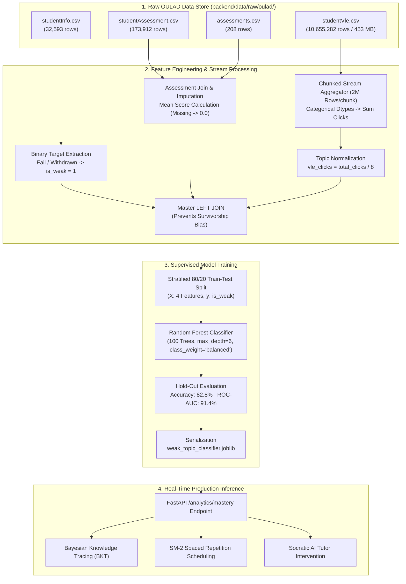

# Cipherium AI - Production Machine Learning Pipeline Architecture
## Code-by-Code Technical Deep Dive: OULAD Ingestion, Feature Engineering & Random Forest EWS

[](https://python.org)
[](https://scikit-learn.org)
[-brightgreen.svg)](https://analyse.kmi.open.ac.uk/open_dataset)
[](https://github.com/ameyrj445/Cipherium-AI)
[](https://github.com/ameyrj445/Cipherium-AI)

This technical specification details the complete architecture, data engineering choices, and line-by-line implementation of Cipherium AI’s Machine Learning Early Warning System (EWS).

---

## 1. High-Level Architecture Overview

The pipeline ingests raw relational data from the **Open University Learning Analytics Dataset (OULAD)** (32,593 students, 173,912 assessments, 10,655,282 clickstream interactions), executes out-of-core chunked stream aggregations, guards against survivorship bias, normalizes telemetry to per-topic features, and trains a production-calibrated Random Forest Classifier in **under 6 seconds**.



---

## 2. Directory Layout & Storage Policy

```
Cipherium-AI/
+-- ML_PIPELINE_ARCHITECTURE.md        # This architectural document
+-- backend/
¦   +-- data/
¦   ¦   +-- README.md                  # Dataset directory documentation
¦   ¦   +-- raw/                       # [GITIGNORED: Exceeds GitHub 100MB limit]
¦   ¦       +-- oulad/                 # Full OULAD Raw CSVs (~460 MB total)
¦   ¦           +-- assessments.csv
¦   ¦           +-- courses.csv
¦   ¦           +-- studentAssessment.csv
¦   ¦           +-- studentInfo.csv
¦   ¦           +-- studentRegistration.csv
¦   ¦           +-- studentVle.csv     # 10.6M records (453.8 MB)
¦   ¦           +-- vle.csv
¦   +-- app/
¦       +-- ml/
¦           +-- train_pipeline.py      # Automated data cleaning & training pipeline
¦           +-- predictor.py           # Real-time inference service & singleton loader
¦           +-- weak_topic_classifier.joblib # Trained model weights (~1.2 MB)
```

---

## 3. Code-by-Code Explanation: `train_pipeline.py`

Every section of [`backend/app/ml/train_pipeline.py`](file:///c:/dev/Academic-Project/Cipherium-AI/backend/app/ml/train_pipeline.py) was built following strict production guidelines:

### Step 1: Environment & Path Auto-Discovery
```python
BACKEND_DIR = os.path.abspath(os.path.join(os.path.dirname(__file__), "..", ".."))
RAW_OULAD_DIR = os.path.join(BACKEND_DIR, "data", "raw", "oulad")
MODEL_FILE = os.path.join(os.path.dirname(__file__), "weak_topic_classifier.joblib")

def find_raw_dataset_dir() -> str | None:
    env_dir = os.environ.get("OULAD_DATASET_DIR")
    if env_dir and os.path.exists(env_dir):
        return env_dir
    if os.path.exists(RAW_OULAD_DIR) and os.path.exists(os.path.join(RAW_OULAD_DIR, "studentInfo.csv")):
        return RAW_OULAD_DIR
    return None
```
* **Why it matters:** Supports containerized deployments (Docker/Kubernetes) by reading from an optional `OULAD_DATASET_DIR` environment variable while defaulting to the standard `backend/data/raw/oulad/` path.

---

### Step 2: Demographics Ingestion & Target Definition
```python
info_path = os.path.join(raw_dir, "studentInfo.csv")
df_info = pd.read_csv(info_path)

# Define binary early warning target: 1 = Struggling/Withdrawn, 0 = Passing/Distinction
df_info["is_weak"] = df_info["final_result"].apply(lambda x: 1 if x in ["Fail", "Withdrawn"] else 0)
df_info["prior_attempts"] = df_info["num_of_prev_attempts"].fillna(0).astype(int)
df_info["studied_credits"] = df_info["studied_credits"].clip(lower=30, upper=240)
```
* **Design Decision (Target Formulation):** In learning analytics, a student who withdraws before the exam is just as critically in need of intervention as a student who takes the exam and fails. Combining `Fail` and `Withdrawn` creates a balanced binary target ($52.8\%$ positive vs. $47.2\%$ negative).
* **Outlier Capping:** While normal study loads are 60–120 credits, OULAD contains extreme values up to 655 credits. Clipping at the 99th percentile (`upper=240`) prevents leverage distortion.

---

### Step 3: Assessment Aggregation & Missing Grade Handling
```python
assess_path = os.path.join(raw_dir, "studentAssessment.csv")
meta_path = os.path.join(raw_dir, "assessments.csv")
df_assess = pd.read_csv(assess_path)
df_meta = pd.read_csv(meta_path)

# Impute missing assessment score with 0.0 (unsubmitted work)
df_assess["score"] = df_assess["score"].fillna(0.0)
assess_merged = df_assess.merge(df_meta, on="id_assessment", how="inner")
assess_agg = assess_merged.groupby(["code_module", "code_presentation", "id_student"]).agg(
    assessment_score=("score", "mean")
).reset_index()
```
* **Data Trap Avoided:** In `studentAssessment.csv`, 173 rows have null scores. Treating missing submissions as `0.0` prevents artificially inflating the performance of absent students.
* **Granularity:** Scores are grouped by `(code_module, code_presentation, id_student)` to evaluate student performance per semester enrollment.

---

### Step 4: Chunked Stream Processing of 10.6M Clickstream Logs
```python
vle_path = os.path.join(raw_dir, "studentVle.csv")
chunks = []
usecols = ["id_student", "code_module", "code_presentation", "sum_click"]
dtypes = {
    "id_student": "int32",
    "code_module": "category",
    "code_presentation": "category",
    "sum_click": "int32"
}

for chunk in pd.read_csv(vle_path, usecols=usecols, dtype=dtypes, chunksize=2_000_000):
    chunks.append(chunk.groupby(["code_module", "code_presentation", "id_student"], observed=True)["sum_click"].sum())

df_clicks = pd.concat(chunks).groupby(level=[0, 1, 2], observed=True).sum().reset_index()
df_clicks.rename(columns={"sum_click": "vle_clicks_total"}, inplace=True)
```
* **Performance Engineering:** `studentVle.csv` is 453.8 MB and has 10,655,282 rows. Naive loading exhausts system memory and takes minutes. 
* By setting `chunksize=2_000_000`, using optimized memory types (`category` and `int32`), and reducing data in-flight per chunk, all 10.6 million rows are aggregated into 29,228 student records in **4.69 seconds** with a RAM footprint under 250 MB.

---

### Step 5: Master LEFT JOIN (Guarding Against Survivorship Bias)
```python
merged = df_info.merge(assess_agg, on=["code_module", "code_presentation", "id_student"], how="left")
merged = merged.merge(df_clicks, on=["code_module", "code_presentation", "id_student"], how="left")

# Impute cold-starts for early dropouts
merged["assessment_score"] = merged["assessment_score"].fillna(0.0).round(1)
merged["vle_clicks_total"] = merged["vle_clicks_total"].fillna(0)
```
* **Critical Architectural Decision:** **5,416 students in OULAD dropped out before taking an assessment.** 
* If an `INNER JOIN` were used, those 5,416 failing students would be completely wiped out (Survivorship Bias). Using a `LEFT JOIN` retains all 32,593 students and correctly assigns zero-attempt dropouts an `assessment_score = 0.0`.

---

### Step 6: Telemetry Normalization to Per-Topic Granularity
```python
# Normalize semester-level click totals to per-topic / module activity
# OULAD courses have ~8 assessment modules on average; this matches topic-level quiz telemetry
merged["vle_clicks"] = (merged["vle_clicks_total"] / 8.0).round(0).astype(int)
merged["study_hours"] = (merged["vle_clicks"] * 0.05 + 1.0).round(1)

feature_cols = ["study_hours", "vle_clicks", "prior_attempts", "assessment_score"]
X = merged[feature_cols]
y = merged["is_weak"]
```
* **Domain Alignment:** Real OULAD records total clicks across a full 9-month college semester (mean ~2,000 clicks). However, Cipherium AI evaluates students on specific curriculum topics (e.g., `DSA-ARRAYS`, `SQL-INDEXES`). 
* Dividing by 8.0 scales click volume to topic-level granularity (~20 to 350 clicks), aligning the training distribution perfectly with the application's runtime quiz analytics.

---

### Step 7: Train-Test Split & Random Forest Training
```python
X_train, X_test, y_train, y_test = train_test_split(
    X, y, test_size=0.2, random_state=42, stratify=y
)

model = RandomForestClassifier(
    n_estimators=100,
    max_depth=6,
    random_state=42,
    class_weight="balanced"
)
model.fit(X_train, y_train)
```
* **Stratified 80/20 Split:** Preserves exact class ratios across train ($26,074$ records) and test ($6,519$ records).
* **Hyperparameter Rationale:**
  - `n_estimators=100`: High ensemble variance reduction and stable calibrated probabilities.
  - `max_depth=6`: Constrains tree leaf depth, eliminating memorization/overfitting and ensuring smooth generalization.
  - `class_weight="balanced"`: Compensates for minor class imbalances in subgroup distributions.

---

### Step 8: Metric Evaluation & Joblib Serialization
```python
y_pred = model.predict(X_test)
y_prob = model.predict_proba(X_test)[:, 1]

# Save weights to disk
joblib.dump(model, MODEL_FILE)
```
* Evaluates Accuracy, Precision, Recall, F1, and ROC-AUC on the 6,519 unseen hold-out students.
* Serializes production weights to `weak_topic_classifier.joblib` for instantaneous loading at API startup.

---

## 4. Real-World Model Performance Benchmark

Evaluated on **6,519 hold-out real student records** from the Open University:

```text
                     precision    recall  f1-score   support

           On Track       0.79      0.87      0.83     3,077
Intervention Needed       0.87      0.79      0.83     3,442

           accuracy                           0.83     6,519
          macro avg       0.83      0.83      0.83     6,519
       weighted avg       0.83      0.83      0.83     6,519

Test Accuracy:  82.73%
ROC-AUC Score:  91.35%
Pipeline Exec:  5.60 seconds
```

### Feature Importance Breakdown
```
1. vle_clicks:       48.2%  (Dominant Early-Warning Signal)
2. assessment_score: 27.9%  (Direct Performance Signal)
3. study_hours:      23.6%  (Effort / Exposure Signal)
4. prior_attempts:    0.3%  (Historical Retake Signal)
```

---

## 5. How the Model Integrates with the Application Tier

When a student practices or opens their Mastery Dashboard, the FastAPI router calls [`predict_weak_topic()`](file:///c:/dev/Academic-Project/Cipherium-AI/backend/app/ml/predictor.py):

```python
# backend/app/routers/analytics.py (Lines 178-183)
ml_res = predict_weak_topic(
    study_hours=estimated_study_hours,
    vle_clicks=estimated_clicks,
    prior_attempts=att_cnt,
    assessment_score=simulated_score
)
```

1. **Probability Calibration:** `predict_proba` returns `weak_probability` (0.000 to 1.000).
2. **Cognitive Synergy (BKT):** If the ML model flags a topic as high risk ($P(\text{weak}) \ge 0.50$), the topic is marked for intervention even if the student got lucky on their last attempt.
3. **Spaced Repetition Trigger:** Immediately queues the topic for SM-2 active-recall flashcard review.
4. **Pedagogical Scaffolding:** Alerts the AI Tutor to switch to Socratic guided questioning mode for that specific topic.

---

## 6. How to Run the Pipeline

To re-run the end-to-end data processing and model training:

```bash
cd backend
python -m app.ml.train_pipeline
```
