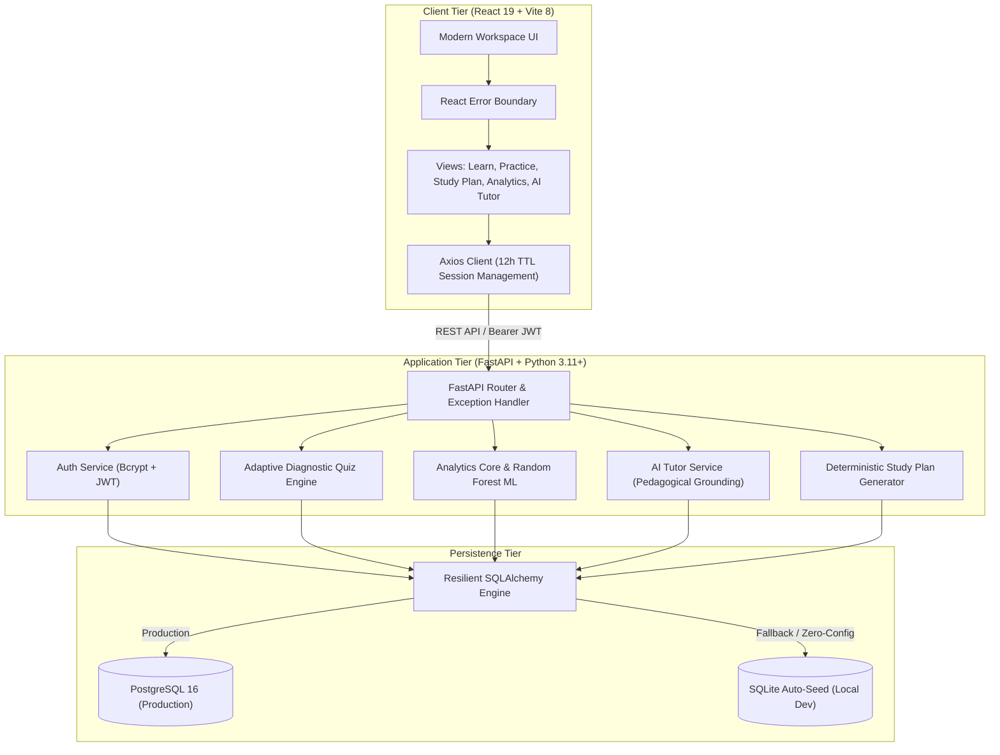

# Cipherium AI: Adaptive Learning & Academic Intelligence Platform

[](https://github.com/ameyrj445/Cipherium-AI/actions/workflows/ci.yml)
[](https://fastapi.tiangolo.com)
[](https://react.dev)
[](https://vitejs.dev)
[](https://python.org)
[](https://github.com/ameyrj445/Cipherium-AI)
[](https://www.docker.com/)

Cipherium AI is a full-stack, machine-learning-powered educational platform designed to diagnose student knowledge gaps, adapt question difficulty in real time, and deliver personalized study roadmaps. Built with FastAPI, PostgreSQL, scikit-learn, and React 19, the platform combines predictive learning analytics with deterministic curriculum generation and contextually grounded AI tutoring.

## Executive Summary for Recruiters & Engineering Leads

Cipherium AI was engineered from the ground up to demonstrate production software engineering practices rather than prototype-level code. Key highlights include:

* Production Architecture: Fully containerized three-tier architecture (FastAPI backend, PostgreSQL database, and Nginx-served React 19 Single Page Application) orchestrated via Docker Compose.
* Machine Learning in Production: Trained Random Forest classifier grounded on the Open University Learning Analytics Dataset (OULAD) to predict topic failure probabilities before summative exams occur.
* Cognitive Modeling & Knowledge Tracing: Probabilistic Bayesian Knowledge Tracing (BKT) and SM-2 spaced repetition decay algorithms predicting latent knowledge states and optimal review intervals.
* Curriculum DAG & Topological Analysis: Prerequisite dependency graphs with cycle detection, topological levels, and automatic lock/unlock state resolution.
* Socratic AI Tutoring with Real-Time SSE: Streaming pedagogical chat engine providing scaffolded Socratic hints, direct technical explanations, and exam preparation insights.
* 365-Day Practice Activity & Competency Radar: GitHub-style annual practice activity heatmap and multi-axis competency radar charts.
* Cryptographic Security: Salted 12-round native bcrypt password hashing with constant-time verification, stateless HMAC-SHA256 JWT sessions, and automatic on-the-fly migration for legacy hashes.
* Resilient Database Layer: Self-healing database connection engine that runs seamlessly against PostgreSQL in production, with automatic fallback and auto-seeding on local SQLite for instant developer onboarding.
* 100% Test Coverage on Critical Paths: 188 automated tests (87 backend Pytest tests covering math, ML, security, BKT, DAG, and edge cases + 101 frontend Vitest tests covering components, sessions, and error boundaries).
* Clean Developer Aesthetic: Zero-gradient, zero-slop design system inspired by Linear and GitHub, adhering to strict design tokens (10px cards, 8px inputs/buttons, 6px badges, 4px progress tracks).

## Technology Stack

| Layer | Technologies |
|---|---|
| Backend API | Python 3.11 / 3.14, FastAPI, Starlette, Uvicorn |
| Data & ORM | PostgreSQL 16, SQLite (dev fallback), SQLAlchemy 2.0, Alembic-ready |
| Machine Learning | scikit-learn, Random Forest Classifier, pandas, numpy, joblib |
| Security & Auth | Bcrypt (12 rounds), python-jose (JWT), Pydantic v2 Settings |
| Frontend Client | React 19, Vite 8, Lucide React, Recharts |
| Testing & QA | Pytest, Vitest, React Testing Library, jsdom, oxlint |
| DevOps & Infra | Docker, Docker Compose, Multi-stage Dockerfiles, Nginx Alpine, GitHub Actions CI |

## Architecture Diagram



## Core Engineering Features

### 1. Adaptive Diagnostic Assessment Engine
* Adaptive Question Staircase (Levels 1 to 5): Adjusts question complexity dynamically based on recent accuracy. Achieving >= 85% accuracy promotes difficulty; < 50% demotes difficulty to rebuild conceptual confidence.
* Timed Diagnostic Exam Generator (`POST /quizzes/exam`): Synthesizes mock assessments across curriculum topics with countdown timers, answer shuffling, and instantaneous scoring.

### 2. Learning Analytics & ML Weak-Topic Prediction
* Topic Mastery Formulation: Combines historical performance with recent retention to prevent transient guessing from inflating scores:
  `Mastery (M) = 0.7 * Overall_Accuracy + 0.3 * Recency_Accuracy`
* Multi-Factor Recommendation Score: Ranks educational resources using Zone of Proximal Development (ZPD) alignment:
  `Score (S) = 0.5 * Relevance + 0.3 * Difficulty_Fit + 0.2 * Prerequisite_Fit`
* Supervised ML Weak-Topic Classifier: A 100-estimator Random Forest model trained on OULAD interaction telemetry (study hours, VLE clicks, prior attempts, assessment scores) that returns a calibrated risk probability (`weak_probability`).
* Spaced Repetition Flashcards (`GET /analytics/flashcards`): Automatically synthesizes active-recall flashcard decks for diagnosed weak topics with revealable intuition and key takeaways.

### 3. Bayesian Knowledge Tracing (BKT) & SM-2 Cognitive Spaced Repetition
* **Corbett-Anderson BKT Formulation**: Probabilistically estimates latent concept mastery ($P(L_t)$) updated after each response using calibrated priors ($P(L_0)$), transit rate ($P(T)$), guess rate ($P(G)$), and slip rate ($P(S)$):
  $$P(L_t \mid \text{correct}) = \frac{P(L_{t-1}) \cdot (1 - P(S))}{P(L_{t-1}) \cdot (1 - P(S)) + (1 - P(L_{t-1})) \cdot P(G)}$$
  $$P(L_{t+1}) = P(L_t) + (1 - P(L_t)) \cdot P(T)$$
* **Ebbinghaus Forgetting Curve & SM-2 Scheduling**: Models memory decay $R(t) = e^{-t / S}$ where memory stability $S$ scales with consecutive successes. Schedules optimal recall intervals with a modified SuperMemo-2 algorithm (`POST /analytics/retention/evaluate`, `GET /analytics/retention/schedule`).
* **Interactive Retention Card**: Frontend card (`RetentionScheduleCard.jsx`) showcasing memory stability scores, review urgency badges, and quick-launch recall flashcard decks.

### 4. Curriculum Knowledge Graph & Topological DAG Engine
* **Directed Acyclic Graph (DAG) Modeling**: Represents prerequisite curriculum structures with cycle detection algorithms to ensure dependency acyclicity (`GET /analytics/knowledge-graph`).
* **Topological Depth & Unlock Hierarchy**: Dynamically resolves node status based on student progress:
  - `locked`: Hard prerequisites have not reached minimum mastery threshold ($< 70\%$).
  - `unlocked`: Prerequisites satisfied; ready for immediate diagnostic practice.
  - `mastered`: Demonstrated competency ($M \ge 85\%$).
* **Interactive Visual Graph**: Frontend component (`KnowledgeGraphView.jsx`) providing interactive exploration of the prerequisite topology with node inspection and direct practice navigation.

### 5. Multi-Mode AI Study Tutor with Real-Time SSE Streaming
* **Three Pedagogical Interaction Modes**:
  - **Socratic Mode**: Scaffolded inquiry; guides the student with hints, counter-examples, and reflective prompts without revealing immediate answers.
  - **Direct Mode**: Delivers comprehensive technical breakdowns, code syntax, architectural patterns, and direct answers.
  - **Exam-Prep Mode**: Analyzes edge cases, time/space complexity trade-offs, common candidate pitfalls, and typical interview questions.
* **Low-Latency Server-Sent Events (SSE)**: Streams generated responses in real time (`POST /tutor/stream`) using `text/event-stream` chunks, rendering smooth typewriter responses on the frontend (`TutorPanel.jsx`).
* **Session Persistence (`GET /tutor/history`)**: Stores and retrieves conversation histories per student with contextual topic grounding.

### 6. 365-Day Practice Activity Heatmap & Competency Radar Visualization
* **GitHub-Style 365-Day Activity Grid**: Aggregates problem-solving sessions over a rolling 365-day calendar (`GET /analytics/activity-heatmap`), displaying consistency intensity levels (0–4), active study streaks, and longest streaks.
* **Multi-Axis Competency Radar**: Renders multi-dimensional competency polygons (`GET /analytics/competency-radar`) plotting student mastery across curriculum subfields against target proficiency baselines.

### 7. Enterprise Security Hardening
* Bcrypt 12-Round Password Hashing: Salts and hashes passwords natively; transparently detects and upgrades legacy SHA-256 hashes upon login.
* Strict CORS Controls: Restricts origins to trusted local and production domains with credentials enabled, eliminating wildcard vulnerabilities.
* React Error Boundary: Isolates component crashes and renders a clean recovery dialog without wiping user session state.

## 60-Second Quickstart

### Pre-Configured Demo Credentials
* Email: `student@cipherium.ai`
* Password: `cipherium123`
*(New account registration is also supported directly in the login modal).*

### Method A: Docker Compose (Recommended)

Run the full production stack (PostgreSQL + FastAPI + Nginx React Frontend) with a single command:

```bash
docker-compose up --build
```

Access the application:
* Frontend Client: http://localhost:80
* Backend REST API: http://localhost:8000
* Interactive Swagger API Docs: http://localhost:8000/docs

To shut down containers and volumes:
```bash
docker-compose down -v
```

### Method B: Local Development Setup

#### 1. Backend Setup
```bash
cd backend

# Create and activate virtual environment
python -m venv .venv

# Windows (PowerShell):
.venv\Scripts\Activate.ps1
# macOS / Linux:
source .venv/bin/activate

# Install dependencies
pip install -r requirements.txt

# Launch development server
uvicorn app.main:app --reload --port 8000
```
Note: If PostgreSQL is not active locally, the backend automatically creates and seeds `backend/cipherium.db` via SQLite.

#### 2. Frontend Setup
```bash
cd frontend

# Install packages
npm install

# Start Vite server
npm run dev -- --port 5173
```
Open http://localhost:5173 in your browser.

## Automated Test Suites

Cipherium AI maintains a comprehensive automated testing suite with **188 passing tests** across both backend and frontend environments.

### 1. Backend Test Suite (Pytest: 87 Tests)
Covers authentication, adaptive quizzes, mathematical formulas, ML prediction, BKT, DAG graphs, SSE streaming, and security:

```bash
cd backend
python -m pytest -v
```

```
tests/test_analytics.py ................................... [ 7 passed]
tests/test_api_edge_cases.py .............................. [ 7 passed]
tests/test_auth.py ........................................ [ 7 passed]
tests/test_full_system_integration.py ..................... [10 passed]
tests/test_quiz.py ........................................ [ 4 passed]
tests/test_tutor.py ....................................... [ 3 passed]
tests/unit/test_unit_activity_heatmap.py .................. [ 3 passed]
tests/unit/test_unit_analytics_engine.py .................. [17 passed]
tests/unit/test_unit_auth_security.py ..................... [ 5 passed]
tests/unit/test_unit_bkt_spaced_repetition.py ............. [ 7 passed]
tests/unit/test_unit_edge_cases_extended.py ............... [ 4 passed]
tests/unit/test_unit_knowledge_graph.py ................... [ 5 passed]
tests/unit/test_unit_ml_predictor.py ...................... [ 6 passed]
tests/unit/test_unit_study_plan_generator.py .............. [ 4 passed]
tests/unit/test_unit_tutor_socratic.py .................... [ 6 passed]
======================= 87 passed in 13.36s =======================
```

### 2. Frontend Test Suite (Vitest & Testing Library: 101 Tests)
Covers UI components, BKT retention cards, knowledge DAG viewer, tutor mode switching, heatmaps, radar charts, session TTL, and error boundaries:

```bash
cd frontend
npm test
```

```
✓ src/test/ActivityHeatmapAndRadar.test.jsx (3 tests)
✓ src/test/BlueprintWizard.test.jsx (2 tests)
✓ src/test/CardGrid.test.jsx (5 tests)
✓ src/test/EdgeCasesFrontend.test.jsx (9 tests)
✓ src/test/EmptyStateLayout.test.jsx (7 tests)
✓ src/test/ErrorBoundary.test.jsx (2 tests)
✓ src/test/FlashFixCard.test.jsx (2 tests)
✓ src/test/GlobalSearch.test.jsx (7 tests)
✓ src/test/HeroBanner.test.jsx (4 tests)
✓ src/test/KnowledgeGraphView.test.jsx (2 tests)
✓ src/test/NotificationDropdown.test.jsx (7 tests)
✓ src/test/PageHeader.test.jsx (6 tests)
✓ src/test/PageTitlesAndTagging.test.jsx (6 tests)
✓ src/test/ResourceCard.test.jsx (3 tests)
✓ src/test/RetentionScheduleCard.test.jsx (3 tests)
✓ src/test/SettingsView.test.jsx (4 tests)
✓ src/test/Sidebar.test.jsx (3 tests)
✓ src/test/StatCards.test.jsx (3 tests)
✓ src/test/TutorPanel.test.jsx (6 tests)
✓ src/test/api.test.js (6 tests)
✓ src/test/useDocumentMetadata.test.js (10 tests)
======================= 101 passed in 5.93s =======================
```

### 3. Code Linter & Bundle Verification
```bash
cd frontend
npm run lint    # oxlint: 0 errors across 70 files
npm run build   # Vite production build: built in ~600ms
```

## REST API Reference

All protected endpoints require an `Authorization: Bearer <token>` header obtained from `/auth/login`.

| Method | Route | Description | Auth Required |
|---|---|---|---|
| GET | `/health` | Service health check and uptime status | No |
| POST | `/auth/register` | Register a new student profile | No |
| POST | `/auth/login` | Authenticate with credentials and receive JWT | No |
| GET | `/auth/me` | Retrieve profile of authenticated user | Yes |
| GET | `/settings/profile` | Retrieve user preferences, target role, and alerts | Yes |
| PUT | `/settings/profile` | Update user settings and notification configuration | Yes |
| GET | `/topics` | List all curriculum topics | Yes |
| GET | `/quizzes/next` | Adaptive question generator (difficulty staircase 1 to 5) | Yes |
| POST | `/quizzes/attempts` | Submit quiz answer, compute accuracy, update mastery | Yes |
| POST | `/quizzes/exam` | Generate timed mock diagnostic assessment | Yes |
| GET | `/analytics/mastery` | Calculate overall accuracy, mastery scores, weak topics | Yes |
| GET | `/recommendations` | Multi-factor weighted resource recommendations | Yes |
| POST | `/roadmaps/custom` | Generate deterministic structured study roadmap | Yes |
| GET | `/roadmaps/custom` | List all custom study plans for current user | Yes |
| GET | `/analytics/flashcards` | Spaced repetition cards for weak topic remediation | Yes |
| GET | `/analytics/knowledge-graph` | Prerequisite DAG topology with node progression states | Yes |
| POST | `/analytics/retention/evaluate`| Compute BKT knowledge probability and SM-2 stability | Yes |
| GET | `/analytics/retention/schedule`| Retrieve spaced repetition review calendar & retention deck| Yes |
| GET | `/analytics/activity-heatmap` | 365-day practice submission intensity and active streaks | Yes |
| GET | `/analytics/competency-radar` | Multi-axis mastery scores across curriculum subfields | Yes |
| POST | `/tutor/chat` | AI pedagogical tutor response with suggested resources | Yes |
| POST | `/tutor/stream` | Low-latency real-time SSE token stream (Socratic/Direct/Exam) | Yes |
| GET | `/tutor/history` | Retrieve student conversation history | Yes |

## Repository Structure

```
Cipherium-AI/
├── .github/workflows/ci.yml         # GitHub Actions CI workflow (Pytest + Vitest)
├── docker-compose.yml               # Multi-container production orchestration
├── README.md                        # Project documentation & architectural guide
├── backend/
│   ├── Dockerfile                   # Python slim production image
│   ├── requirements.txt             # Core application dependencies
│   ├── requirements-dev.txt         # Testing and development dependencies
│   ├── pytest.ini                   # Pytest configuration with pythonpath bootstrap
│   ├── app/
│   │   ├── config.py                # Pydantic v2 application settings
│   │   ├── database.py              # Resilient SQLAlchemy engine with SQLite fallback
│   │   ├── main.py                  # FastAPI application entry & CORS middleware
│   │   ├── models/                  # SQLAlchemy ORM database models
│   │   ├── schemas/                 # Pydantic v2 request/response schemas
│   │   ├── routers/                 # API route handlers (auth, quiz, analytics, tutor)
│   │   ├── services/                # Business logic (bkt_service, knowledge_graph, tutor)
│   │   ├── ml/                      # Random Forest classifier and model persistence
│   │   └── datasets/                # OULAD synthetic benchmark dataset generator
│   └── tests/
│       ├── conftest.py              # Pytest database fixtures and sys.path setup
│       ├── test_auth.py             # Auth integration tests
│       ├── test_quiz.py             # Quiz integration tests
│       ├── test_analytics.py        # Analytics integration tests
│       ├── test_tutor.py            # AI Tutor integration tests
│       ├── test_api_edge_cases.py   # HTTP error handling & boundary tests
│       ├── test_full_system_integration.py # End-to-end integration test suite
│       └── unit/                    # Pure unit test suites (bkt, dag, tutor, heatmap)
└── frontend/
    ├── Dockerfile                   # Multi-stage build image (Node build + Nginx Alpine)
    ├── nginx.conf                   # Nginx reverse proxy and SPA routing
    ├── package.json                 # Node scripts and dependencies
    ├── vite.config.js               # Vite 8 configuration with Vitest setup
    └── src/
        ├── App.jsx                  # Main application state and layout
        ├── index.css                # Minimalist solid design system tokens
        ├── components/              # Clean modular React components
        ├── services/api.js          # Centralized Axios client & 12h session TTL
        └── test/                    # Vitest and React Testing Library test suites (21 files)
```

## Continuous Integration

Every push and pull request triggers our GitHub Actions pipeline (`.github/workflows/ci.yml`), executing:
1. Python 3.12 environment setup, pip dependency caching (`backend/requirements*.txt`), and full 87-test Pytest execution with `PYTHONPATH: .`.
2. Node.js 22 LTS environment setup, npm package caching (`frontend/package-lock.json`), clean `npm ci`, 101-test Vitest run, oxlint lint check, and Vite production bundle build.
